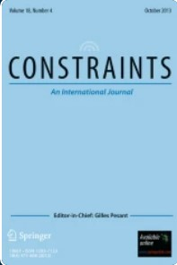

  
This issue includes “Commentaries” on some of the most highly-cited papers published in the journal.

**[Introduction to the Constraints journal Thirtieth Anniversary special issue](https://rdcu.be/uPuGrn2sg9Ca)**   
Eugene C. Freuder  
video in progress

**[Revisited: solving hard qualitative temporal reasoning problems](https://rdcu.be/ftchJ)**   
Bernhard Nebel  
video in progress

**[Constraint-based attribute and interval planning: a commentary](https://rdcu.be/ZTZyK6zDaoqa)**   
Jeremy Frank and Ari Jónsson  
video in progress

**[Semiring–based and valued CSPs revisited](https://rdcu.be/ftckU)**   
Stefano Bistarelli and Hélène Fargier and Francesca Rossi and Thomas Schiex  
video in progress

**[Utilizing simple tabular reduction wisely](https://rdcu.be/ftcmU)**   
Christophe Lecoutre  
video in progress

**[Automatically configuring constraint satisfaction programs: a retrospective](https://rdcu.be/ftcna)**   
Steven N. Minton  
video in progress

**[Commentary on “Cardinality Networks: a theoretical and empirical study”](https://rdcu.be/ftcnO)**   
Roberto Asín-Achá, Robert Nieuwenhuis, Albert Oliveras and Enric Rodríguez-Carbonell  
video in progress

**[Lazy clause generation in retrospect](https://rdcu.be/ftcoH)**   
Olga Ohrimenko, Peter J. Stuckey and Michael Codish  
video in progress

**[Conditional temporal planning: how chance encounters and casual collaborations may raise great expectations](https://rdcu.be/ftcp0)**   
Thierry Vidal  
video in progress

**[Comments on “Constraint models for the covering test problem”](https://rdcu.be/ftuKM)**   
Brahim Hnich, Steven D. Prestwich, Evgeny Selensky and Barbara M. Smith  
video in progress

**[The global constraint catalogue: a retrospective on organic growth and unplanned emergence](https://rdcu.be/ftuKZ)**   
Nicolas Beldiceanu, Sophie Demassey and Thierry Petit  
video in progress

**[Commentary on “Musical harmonization with constraints: a survey”](https://rdcu.be/ftyaX)**   
François Pachet and Pierre Roy  
video in progress

**[Reflections on Essence: a constraint language for specifying combinatorial problems](https://rdcu.be/ftAFs)**   
Alan M. Frisch, Christopher Jefferson and Ian Miguel  
video in progress

**[Practical applications of constraint programming: retrospective](https://rdcu.be/ftIs1)**   
Mark Wallace  
video in progress

**[Radio link frequency assignment revisited](https://rdcu.be/HDEQR8zU9jsa)**   
Simon de Givry and Thomas Schiex  
video in progress

**[Probe backtrack search, revisited](https://rdcu.be/uemCrj58CHta)**   
Hani ElSakkout and Mark Wallace  
video in progress

**[Markov constraints revisited: commentary on “Markov constraints: steerable generation of Markov sequences”](https://rdcu.be/RPUwqNkSXfia)**   
François Pachet and Pierre Roy  
video in progress

**[Commentary on paper: ”Learning the travelling salesperson problem requires rethinking generalization”](https://rdcu.be/fsdQx)**   
Quentin Cappart, Chaitanya K. Joshi and Louis-Martin Rousseau  
video in progress

**[The legacy of the Zinc modelling language](https://link.springer.com/article/10.1007/s10601-026-09405-5)**   
Kimbal Marriott, Reza Rafeh, Peter J. Stuckey, Maria Garcia de la Banda and Mark Wallace  
video in progress

**[A cost-regular based hybrid column generation approach: a commentary](https://rdcu.be/7gjRNvUYVBpa)**   
Sophie Demassey, Gilles Pesant and Louis-Martin Rousseau  
video in progress